# Organizzou — Phase 0 plan

Status: **awaiting approval**. No application code has been written for this phase.
Sources read: `CLAUDE.md`, `docs/PRD.md`, `docs/PROMPT-BUILD-APP.md`, `docs/design-system/DESIGN-SYSTEM.md`, the current project.

## 1. Current state of the project

- Next.js 16.4.3 (Turbopack), React 19.3, Tailwind v4, shadcn Nova (radix), design system foundation done
  (tokens, theme, 29 shadcn components, `src/components/organizzou/*`, `/design-system` showcase).
- `next.config.ts` has `cacheComponents: true` and `partialPrefetching: true`. This changes data-fetching rules
  (dynamic data must sit under `<Suspense>`; `"use cache"` replaces the old fetch caching). Phase 1 must follow
  `node_modules/next/dist/docs/01-app/01-getting-started/08-caching.md`.
- Next 16 renamed `middleware.ts` to **`proxy.ts`** (`.../03-file-conventions/proxy.md`). Supabase session refresh goes there.
- No Supabase, zod, react-hook-form, dnd-kit, Anthropic SDK or PWA packages installed yet. No git remote; one commit.
- `CLAUDE.md` mentions `npm run typecheck`; that script does not exist yet (Phase 1 adds `"typecheck": "tsc --noEmit"`).
- No Mobbin MCP and no shadcn MCP are available in this session. I use the shadcn CLI, and design from the design system alone unless you connect Mobbin.

## 2. Spec conflicts and how I resolve them (tell me if you disagree)

| Topic | Conflict | Resolution |
|---|---|---|
| Module colors | PRD: accent color per module, card colors, event/subject colors | Icon only. User-chosen colors = fixed swatch set from the 6 colors (see §7) |
| Name | PRD lists name finalists | Organizzou (already decided) |
| Routes | `modules.ts` has `hoje → /`; master prompt says `/hoje` | Dashboard lives at `/hoje`; `/` redirects to it when logged in. I will update `modules.ts` |
| BottomNav | Component has 4 items + "+"; master prompt: Hoje · Tarefas · + · Finanças · Mais | 4 items = Hoje, Tarefas, Finanças, Mais (sheet with all modules) |
| Errors/finance | Design system has no red/green | Icon + sign + text, always. Negative balances use `−` and `arrow-down-right` |
| Light-mode Lima | Lima is invisible on Papel | Any Lima chip in light mode carries Tinta text (`highlight` token) |

## 3. Folder architecture

```
src/
  app/
    (public)/                 landing redirect, termos, privacidade
    (auth)/entrar, cadastrar, recuperar-senha, redefinir-senha, auth/callback
    (app)/                    authenticated shell (sidebar + BottomNav + FAB + Cmd K)
      hoje/ tarefas/ rotina/ agenda/ financas/ treinos/ dieta/ estudos/
      notas/ cofre/ metas/ diario/ configuracoes/
    api/
      assistant/              POST chat (stream), POST confirm
      whatsapp/webhook/       GET verify, POST receive
      cron/                   reminders, morning-summary, weekly-review
      stt/                    audio -> text
      open-finance/           connect, webhook, sync
    design-system/            showcase (dev only)
    manifest.ts, sw.ts        PWA
  components/
    ui/                       shadcn (do not hand-edit beyond design-system tweaks)
    organizzou/               shared Organizzou components
    <module>/                 module-specific components (tarefas/, financas/, ...)
  features/<module>/          actions.ts (server actions), queries.ts, schemas.ts (zod), types.ts
  server/
    assistant/                engine.ts, tools/<module>.ts, confirm.ts, audit.ts, prompts.ts
    whatsapp/                 client.ts, signature.ts, templates.ts, linking.ts
    stt/                      provider adapter
    openfinance/              provider adapter (Pluggy | Belvo)
    notifications/            push.ts, scheduler.ts
  lib/
    supabase/                 client.ts, server.ts, proxy.ts, admin.ts, types.ts (generated)
    vault/                    crypto.ts (browser only), kdf.ts
    date.ts, money.ts, format.ts   pt-BR helpers (date-fns ptBR, cents -> R$)
  hooks/
  proxy.ts                    session refresh + route protection
supabase/
  migrations/                 timestamped SQL, one concern per file
  seed.sql
  tests/                      pgTAP RLS tests
tests/                        Vitest (unit), Playwright (e2e)
extension/                    Manifest V3 (own package.json, Phase 10)
docs/                         PRD, plan, SETUP.md (Phase 10)
```

Rules: Server Components by default; writes only via Server Actions or Route Handlers; every action validates with
zod from `features/<module>/schemas.ts`. The same zod schemas are reused as assistant tool input schemas, so the app and
the assistant can never accept different data.

## 4. Data model (ERD)

Conventions for every table: `id uuid pk default gen_random_uuid()`, `user_id uuid not null references auth.users on delete cascade`,
`created_at`, `updated_at` (trigger). Money in **integer cents** (`bigint`). Times in `timestamptz`; the user's
timezone lives on `profiles`. RLS enabled on all; policy `user_id = (select auth.uid())` for select/insert/update/delete.
Child tables carry `user_id` too (denormalized) so each policy stays a single cheap check, plus a composite FK or
trigger guaranteeing the parent belongs to the same user.

```mermaid
erDiagram
  profiles ||--o{ tags : has
  profiles ||--o{ attachments : has
  profiles ||--o{ audit_log : has

  boards ||--o{ board_lists : has
  board_lists ||--o{ tasks : holds
  tasks ||--o{ task_checklist_items : has
  tasks ||--o{ task_comments : has
  tasks ||--o{ task_tags : has
  tags ||--o{ task_tags : labels

  habits ||--o{ habit_logs : has

  events }o--o| habits : "optional link"
  events ||--o{ event_reminders : has

  accounts ||--o{ transactions : has
  categories ||--o{ transactions : classifies
  categories ||--o{ budgets : limits
  accounts ||--o{ recurring_bills : pays
  open_finance_connections ||--o{ accounts : feeds
  financial_goals }o--o| accounts : tracks

  workout_plans ||--o{ workout_plan_exercises : has
  exercises ||--o{ workout_plan_exercises : used_in
  workout_plans ||--o{ workout_sessions : performed
  workout_sessions ||--o{ set_logs : has
  exercises ||--o{ set_logs : of

  meals ||--o{ meal_items : has
  foods ||--o{ meal_items : of

  subjects ||--o{ study_schedule_blocks : scheduled
  subjects ||--o{ study_sessions : studied
  subjects ||--o{ study_goals : targets
  subjects ||--o{ flashcard_decks : has
  flashcard_decks ||--o{ flashcards : has
  subjects ||--o{ exams_deadlines : has
  subjects ||--o{ notes : "optional link"

  note_folders ||--o{ notes : holds
  notes ||--o{ reminders : "optional link"

  life_goals ||--o{ life_goal_links : links
  streaks }o--|| habits : "optional"
  whatsapp_links ||--o{ whatsapp_messages : has
  vault_folders ||--o{ vault_items : holds
```



### 4.1 Tables by phase (column sketch)

**Phase 1 — core + tasks**
- `profiles` (pk = `auth.users.id`; `display_name`, `timezone` default `America/Sao_Paulo`, `locale` default `pt-BR`,
  `theme` check in (dark, light), `onboarding` jsonb). Created by trigger on signup.
- `tags` (name, swatch), `attachments` (bucket path, mime, size, `entity_type`, `entity_id`),
  `audit_log` (`actor` check in (app, assistant, whatsapp), `action`, `entity_type`, `entity_id`, `payload` jsonb,
  `confirmed_at`; **insert-only for users** — no update/delete policy).
- `boards` (name, position, archived), `board_lists` (board_id, name, position, `is_done_list`),
  `tasks` (board_id, list_id, title, description, `priority` check in (none, low, medium, high), `due_at`, `category`,
  `swatch`, position, `completed_at`, `archived`), `task_checklist_items` (task_id, text, done, position),
  `task_comments` (task_id, body), `task_tags` (task_id, tag_id).
- Positions use fractional ordering (`double precision`, or `text` lexorank) so a drag updates one row.

**Phase 4** `habits` (name, `type` check in (fixed, goal), target_qty, unit, schedule jsonb (weekdays / times), deadline, paused),
`habit_logs` (habit_id, `log_date date`, qty, unique(habit_id, log_date)), `events` (title, starts_at, ends_at, all_day,
description, category, swatch, `rrule`, timezone), `event_reminders` (event_id, offset_minutes).

**Phase 5** `accounts`, `categories` (name, icon, `monthly_limit_cents`), `transactions` (account_id, category_id,
`kind` in/out, `amount_cents` > 0, `occurred_on`, method, description, `source` manual|open_finance, `external_id`
unique per user for dedupe), `recurring_bills` (name, amount_cents, due_day, active, last_paid_on), `budgets`
(month, category_id nullable, amount_cents), `financial_goals` (target_cents, current_cents, deadline).

**Phase 6** `exercises`, `workout_plans`, `workout_plan_exercises`, `workout_sessions`, `set_logs` (reps, load_kg);
personal records are a **view**, not a table. `foods` (nullable `user_id` = shared catalog; read-only to users),
`meals`, `meal_items`, `diet_goals`, `water_logs`, `weight_logs`, `sleep_logs`, `journal_entries` (mood 1–5).

**Phase 7** `subjects`, `study_schedule_blocks`, `study_sessions`, `study_goals`, `flashcard_decks`, `flashcards`
(SM-2: ease, interval_days, repetitions, due_on), `exams_deadlines`, `note_folders`, `notes` (content jsonb, pinned,
`subject_id`), `reminders` (remind_at, channels text[], status), `life_goals` + `life_goal_links`
(`entity_type`, `entity_id`; small addition to the draft so goals can link to any module), `streaks`, `achievements`, `user_levels`.

**Phase 8 — `vault` schema (isolated)**: `vault.folders`, `vault.items` (`type`, `ciphertext bytea`, `iv`, `version`),
`vault.keys` (kdf, salt, params, encrypted verification blob). `open_finance_connections` (provider, item id, status).

**Phase 9** `whatsapp_links` (phone E.164, verified_at, opt_in_at, opt_out_at, code hash, attempts),
`whatsapp_messages` (direction, wa_message_id unique, type, text, status), `notification_preferences`, `push_subscriptions`.

Decision for you: I build only the Phase 1 tables in Phase 1 and migrate each module's tables with its own phase,
instead of migrating everything now. This keeps migrations reviewable. The ERD above is the agreed target.

### 4.2 Vault isolation (the "assistant never sees it" guarantee)

- Own schema `vault`; **no grants** on it to the roles the assistant engine uses.
- Two server DB clients: `appClient` (user JWT, RLS) for the app, and `assistantClient` (a dedicated Postgres role
  `assistant_role` or a user-scoped client with a restricted JWT claim). `assistant_role` has `USAGE` on `public`
  only and explicitly `REVOKE ALL ON SCHEMA vault`.
- Assistant tool registry has no vault tool; a unit test asserts the registry contains none, and a pgTAP test asserts
  `assistant_role` gets `permission denied` on `vault.*`.
- Note: Supabase's Data API exposes only schemas listed in settings; `vault` is not added to that list. The browser reaches
  it through a dedicated route that only stores/returns ciphertext.

## 5. Route map

| Route | Module | Phase |
|---|---|---|
| `/entrar`, `/cadastrar`, `/recuperar-senha`, `/redefinir-senha`, `/auth/callback` | Auth | 1 |
| `/hoje` | Dashboard | 1 shell, 2 content |
| `/tarefas`, `/tarefas/[boardId]`, card as intercepted modal route `/tarefas/[boardId]/[taskId]` | Tasks | 2 |
| `/rotina` | Routine | 4 |
| `/agenda?visao=mes|semana|dia` | Calendar | 4 |
| `/financas` (+ `/contas`, `/categorias`, `/metas`) | Finance | 5 |
| `/treinos`, `/dieta` | Workouts, Diet | 6 |
| `/estudos` (+ `/flashcards`) | Studies | 7 |
| `/notas` | Notes & reminders | 7 |
| `/metas`, `/diario` | Life goals, journal | 6–7 |
| `/cofre` | Vault | 8 |
| `/configuracoes` (+ `/whatsapp`, `/notificacoes`, `/conta`) | Settings | 1, grows |
| `/api/assistant`, `/api/whatsapp/webhook`, `/api/cron/*`, `/api/stt` | Server | 3, 9 |

Public landing at `/` redirects to `/hoje` (logged in) or `/entrar`.

## 6. Dependencies

Phase 1: `@supabase/supabase-js`, `@supabase/ssr`, `zod`, `react-hook-form`, `@hookform/resolvers`, `date-fns` (already),
`vitest`, `@testing-library/react`, `@playwright/test`, `supabase` CLI (dev). Script `typecheck`.
PWA (Phase 1 manifest, Phase 10 offline): `serwist` + `@serwist/next` (confirm it supports Next 16 Turbopack; otherwise
a hand-written `sw.ts` registered from the app).
Phase 2: `@dnd-kit/core`, `@dnd-kit/sortable`, `@dnd-kit/utilities`.
Phase 3: `@anthropic-ai/sdk`.
Phase 6–7: `@tiptap/react` + starter kit (rich text, Phase 7); `ts-fsrs` or own SM-2 (own, ~40 lines).
Phase 8: `hash-wasm` (Argon2id in the browser) with PBKDF2 fallback; `pluggy-sdk` or `belvo` per your choice.
Phase 9: `web-push`.
New dependencies with lock-in (Tiptap, Pluggy/Belvo, STT provider) will be confirmed with you in their phase.

## 7. Fixed swatch set (user-selectable "colors")

Built only from the 6 colors, each with guaranteed text contrast: **Lima** (Tinta text), **Lima verso** (Tinta text),
**Tinta verso** (Papel text), **Grafite** (Papel text), **Papel** (Tinta text, with border), **Neutro** (foreground 8% fill).
Stored as a text enum `swatch` (`lima | lima-verso | tinta-verso | grafite | papel | neutro`), rendered by one
`Swatch` component using theme tokens. No free color picker, no hex in the database.

## 8. Environment variables

| Var | Scope | Phase |
|---|---|---|
| `NEXT_PUBLIC_SUPABASE_URL`, `NEXT_PUBLIC_SUPABASE_ANON_KEY` (publishable) | client-safe | 1 |
| `SUPABASE_SERVICE_ROLE_KEY` | server only (cron, webhook, admin) | 1 |
| `ASSISTANT_DB_URL` or assistant role credentials | server only | 3 |
| `NEXT_PUBLIC_SITE_URL` | public | 1 |
| `ANTHROPIC_API_KEY`, `ANTHROPIC_MODEL` | server only | 3 |
| `STT_PROVIDER`, `STT_API_KEY` | server only | 3 |
| `WHATSAPP_PHONE_NUMBER_ID`, `WHATSAPP_ACCESS_TOKEN`, `WHATSAPP_APP_SECRET`, `WHATSAPP_VERIFY_TOKEN`, `WHATSAPP_BUSINESS_ACCOUNT_ID` | server only | 9 |
| `OPEN_FINANCE_PROVIDER`, `PLUGGY_CLIENT_ID/SECRET` or `BELVO_SECRET_ID/PASSWORD` | server only | 8 |
| `VAPID_PUBLIC_KEY` (public copy), `VAPID_PRIVATE_KEY`, `VAPID_SUBJECT` | push | 9 |
| `CRON_SECRET` | server only | 9 |

`.env.example` is kept in sync with every phase. Nothing sensitive uses the `NEXT_PUBLIC_` prefix.

## 9. Assistant engine (shape, for Phase 3)

`src/server/assistant/engine.ts` exposes `run({ userId, channel: "app" | "whatsapp", input })`. Tools are defined once per
module as `{ name, description, input: zodSchema, handler, sensitive?: boolean }`. Sensitive tools (delete, bulk edits,
anything that moves money) do not execute: they store a pending action (`audit_log` row with `confirmed_at null`) and return a
confirmation request; execution happens only on the confirm endpoint / WhatsApp button reply. Every executed action writes
`audit_log` with the actor. Replies are short pt-BR. Handlers use the user-scoped client, so RLS still applies.

## 10. Quality gate and testing

Every phase: `npm run lint`, `npm run typecheck`, `npm run build`, Vitest (schemas, money/date helpers, assistant tool
registry), pgTAP (RLS: user A cannot read/write user B's rows, per table), Playwright (auth flow, create task, drag card)
at 375 px and 1280 px in both themes. CI workflow in `.github/workflows` once a remote exists.

## 11. Phase 1 scope preview (what I'd do right after your OK)

Supabase wiring and `proxy.ts`; migrations `0001_core`, `0002_tasks` with RLS and pgTAP tests; generated types; auth screens
in pt-BR; app shell (sidebar, BottomNav with "Mais" sheet, AssistantFab placeholder, Cmd/Ctrl+K shell); settings with theme
toggle persisted to `profiles`; manifest + icons. `/hoje` is an empty state.

## 12. Open questions

1. **Supabase**: do you already have a project (URL + keys)? Or should I use the local Supabase CLI (Docker) for development and you create the cloud project later?
2. **Auth**: e-mail + password only in Phase 1, or also Google login? (PRD says "e-mail/usuário + senha".) Username login needs an extra `profiles.username` and a lookup; I recommend e-mail only now, passkeys/2FA later in Phase 10.
3. **Migrations scope**: OK to migrate per phase (my proposal) rather than the whole schema now?
4. **Speech-to-text provider** (Phase 3): OpenAI Whisper/`gpt-4o-transcribe`, Google Speech-to-Text, or Deepgram? My pick: OpenAI transcription, good pt-BR quality and simple API.
5. **Open Finance** (Phase 8): Pluggy or Belvo? My pick: Pluggy (Brazil-first, simpler sandbox).
6. **Claude model** for the assistant: confirm default `claude-sonnet-5-5` for chat, with Haiku 5.5 for classification of quick capture? Kept in `ANTHROPIC_MODEL`.
7. **Mobbin MCP**: not available here. Connect it if you want reference lookups; otherwise I design straight from the design system.
8. **Brand/legal**: the app needs privacy policy and terms pages (LGPD, Meta review). Should I draft pt-BR placeholders in Phase 1?
9. **Currency/locale**: BRL and pt-BR only, single timezone per user (default `America/Sao_Paulo`). Any need for multi-currency? I assume no.
10. **Next 16 `cacheComponents`**: keep it on (it is in the template config)? It forces Suspense boundaries around per-user data, which fits our loading skeletons, but adds a learning curve. I recommend keeping it.
11. **Git**: want me to create a branch per phase and commit in small steps (no remote yet)? The attribution trailer is added to commits.
12. **Extension**: Chrome/Edge only first, Firefox later in Phase 10?
